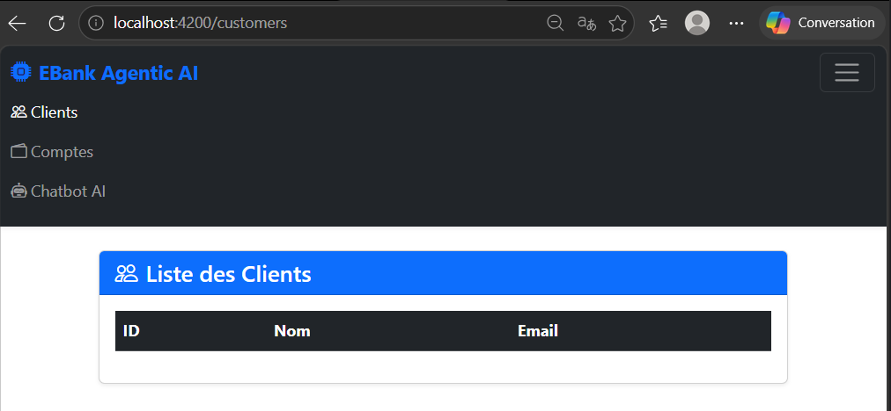
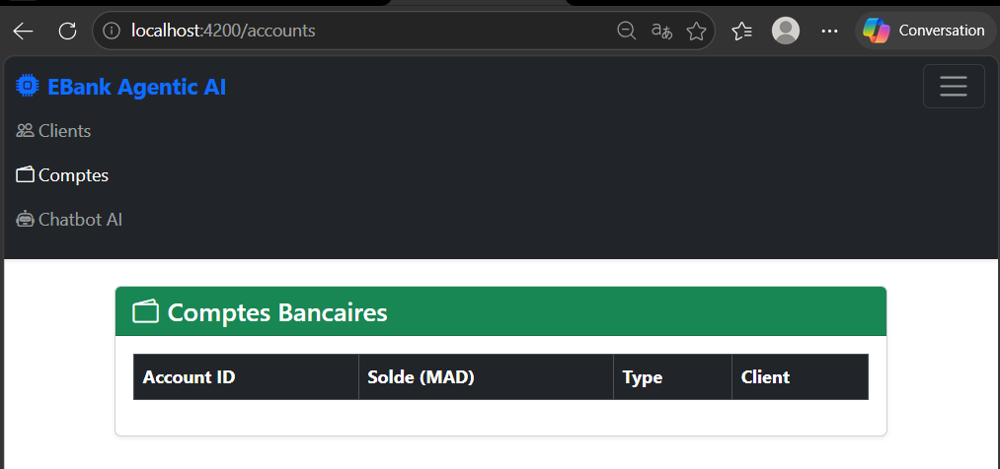
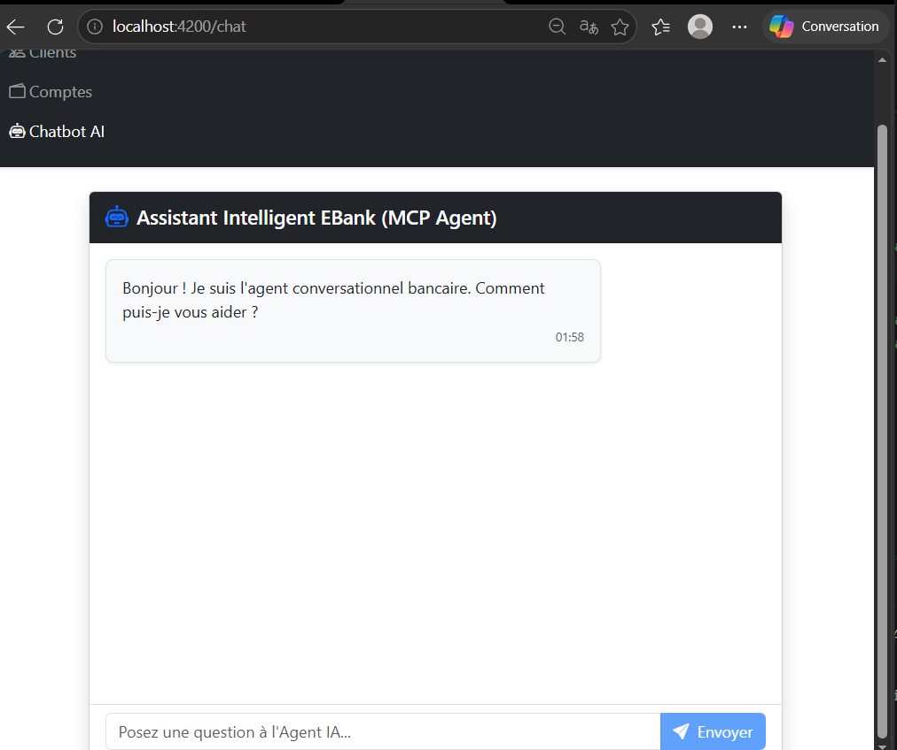

# Application Microservices E-Banking & Chatbot Agentic AI

Projet d'architecture distribuée à base de microservices **Spring Cloud**, d'un **Agent IA autonome** (Spring AI + Ollama) avec intégration Telegram, et d'un frontend moderne **Angular 21 (Standalone)**.

## Architecture du Système

- **Configuration & Découverte** : Spring Cloud Config, Eureka Discovery / Consul
- **Gateway & Sécurité** : Spring Cloud Gateway, Keycloak (OAuth2 / OIDC)
- **Services Métiers** :
    - `Customer-Service` : Gestion des clients (Base DB)
    - `Ebank-Service` : Gestion des comptes bancaires (Communication OpenFeign)
- **Agentic AI & Communication** :
    - `Ebank-Chatbot-Service` : Agent IA développé avec **Spring AI**
    - **MCP (Model Context Protocol)** : Interconnexion entre l'Agent et les Microservices
    - **Bot Telegram** : Interface de chat conversationnelle pour les utilisateurs
- **Frontend** : Application Angular

## Architecture du Système

```text
                                  +-----------------------+
                                  |   Telegram Bot API    |
                                  +-----------+-----------+
                                              |
                                              v
+------------------+             +------------------------+
|  Angular Client  | ----------> |    Gateway Service     | (Port 8080)
|   (Standalone)   |             +-----------+------------+
+------------------+                         |
                                             | (Service Discovery via Eureka)
                    +------------------------+------------------------+
                    |                        |                        |
                    v                        v                        v
         +-------------------+    +--------------------+    +--------------------+
         | Customer Service  |    |   EBank Service    |    |   Chatbot AI Service|
         |    (Port 8081)    |    |    (Port 8082)     |    |    (Port 8083)     |
         +-------------------+    +--------------------+    +---------+----------+
                                                                      |
                                                                      v
                                                            +------------------+
                                                            |   Ollama LLM     |
                                                            |  (llama3.2:3b)   |
                                                            +------------------+
```

## Fonctionnalités Réalisées

### 1. Infrastructure Microservices (Spring Cloud)
* **Discovery Service (`eureka-service`)** : Serveur de registre et découverte Eureka fonctionnant sur le port `8761`.
* **Gateway Service (`gateway-service`)** : Point d'entrée unique de l'architecture (Port `8080`) assurant le routage dynamique vers l'ensemble des microservices.

### 2. Microservices Métiers
* **Customer Service (`customer-service`)** : Gestion complète des données clients à l'aide de Spring Data JPA et d'interfaces REST (Port `8081`).
* **EBank Service (`ebank-service`)** : Gestion des comptes bancaires et des transactions financières (Port `8082`), communiquant de manière transparente avec le service client via **OpenFeign**.

### 3. Agentic AI & Intelligence Artificielle (`ebank-chatbot-service`)
* **Moteur LLM Local** : Intégration de **Spring AI** combiné au modèle local **Ollama (`llama3.2:3b`)** sur le port `8083`.
* **MCP / Tool Calling** : Capacité de l'Agent IA à exécuter de manière autonome des fonctions métiers Java (`getAccountDetails`, `getCustomerDetails`) pour formuler des réponses précises selon le contexte.
* **Intégration Telegram** : Déploiement d'un bot conversationnel interactif en temps réel via l'API `TelegramLongPollingBot`.

### 4. Frontend Web (Angular Standalone)
* Application Single Page (SPA) développée sous **Angular 21** en architecture basée sur des composants autonomes (*Standalone Components*).
* Interface utilisateur fluide intégrant **Bootstrap 5** et **Bootstrap Icons**.
* Communication HTTP réactive (`HttpClient`) connectée au API Gateway.

---

## Aperçu de l'Application Frontend

| Section | Interface Utilisateur |
| :--- | :--- |
| **Gestion des Clients** |  |
| **Comptes Bancaires** |  |
| **Assistant Agentic AI** |  |

---

## Stack Technique

| Domaine | Technologies |
| :--- | :--- |
| **Backend** | Java 17, Spring Boot 3, Spring Cloud (Eureka, Gateway, OpenFeign) |
| **Intelligence Artificielle** | Spring AI, Ollama (`llama3.2:3b`), TelegramBots API |
| **Frontend** | Angular 21 (Standalone Architecture), Bootstrap 5, RxJS |
| **Base de Données & Outils** | H2 Database, PostgreSQL, Maven, Git, IntelliJ IDEA |

---

## Prochaines Étapes
- [ ] **Sécurisation Keycloak** : Implémentation d'une authentification centralisée OpenID Connect / OAuth2 (SSO) pour le Gateway et le Frontend.
- [ ] **Conteneurisation Docker** : Orchestration globale de l'ensemble des conteneurs via `docker-compose.yml`.